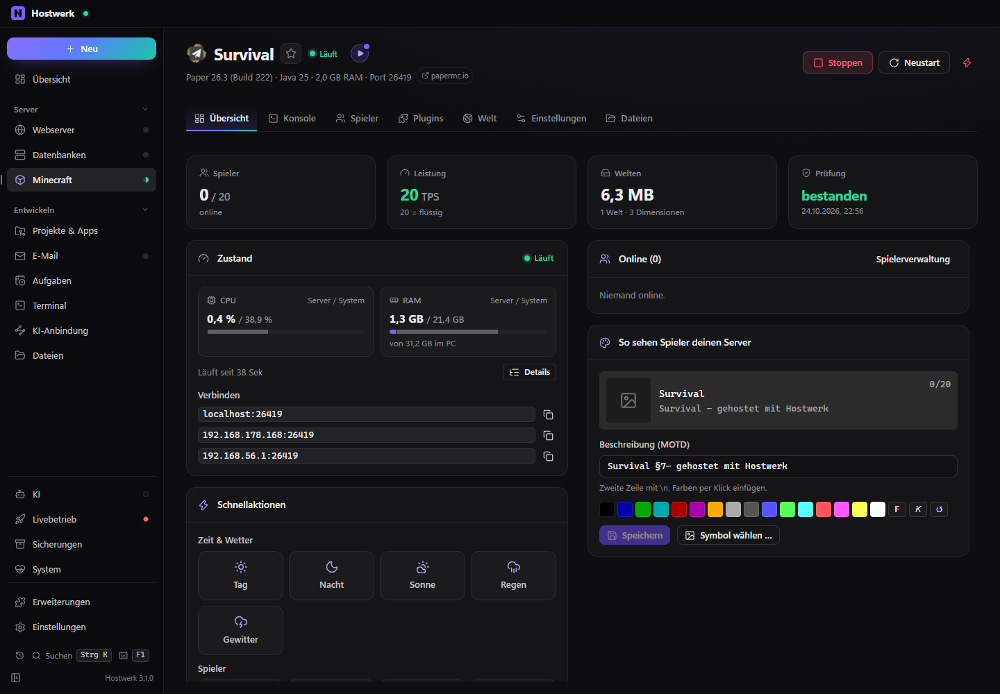

# Minecraft-Server

> **Seit 1.1 mit MOTD-Studio:** Die Beschreibung in der Serverliste gestaltest du direkt in der Übersicht jedes Servers (Farben, Verläufe, Platzhalter, Varianten, Vorschau wie im Spiel); der große Editor mit allen Farbcodes ist der Reiter „MOTD-Studio“ in der Serverliste. Wer die Erweiterung „MOTD-Studio“ hatte, bekommt diese Fassung automatisch; Varianten bleiben.

Minecraft-Server mit Paper, Purpur, Folia, Fabric, NeoForge, Forge, Velocity, Bedrock und Modpacks: anlegen oder übernehmen, Konsole, Spieler, Plugins und Mods aus Modrinth und Hangar, Plugin-Live-Update ohne Neustart, Welten mit allen Dimensionen, Zustand im Detail, Sicherungen, Zeitplan, sichere Updates mit Probelauf.

[English](README.md) · Offizielle [Hostwerk](https://github.com/Passimoritz/hostwerk-public)-Erweiterung (native Erweiterung, ab Hostwerk 3.1)



## Was sie kann

- **Wo:** Minecraft in der Seitenleiste (`#/mc`, wie bisher) – je Server Übersicht, Konsole, Spieler, Plugins/Mods, Welten, Sicherungen und Einstellungen
- Server **anlegen oder übernehmen**: Paper, Purpur, Folia, Fabric, NeoForge, Forge, Velocity, Bedrock Dedicated Server und Modpacks (Modrinth, CurseForge); vorhandene Server-Ordner werden dort übernommen, wo sie liegen
- **Konsole** mit Befehlsvorschlägen, **Spieler** mit OP, Whitelist und Banns per Rechtsklick, Statistik und Aktivität je Wochentag
- **Plugins und Mods** aus Modrinth und Hangar, eigene Quellen (GitHub, SpigotMC, Jenkins, eigener Projektordner), Formulare für die Einstellungen beliebter Plugins
- **Plugin-Live-Update** ohne Neustart über das Helfer-Plugin HostwerkBridge – auch für Plugins, von denen andere abhängen (sie werden mit neu geladen); Deploy-Skript oder Ordnerüberwachung für eigene Plugin-Projekte
- **Zustand im Detail:** CPU und RAM als „Server / System“, Java-Speicher, CPU je Aufgabe, Welten, Plugins und Speicherplatz
- **Welten mit allen Dimensionen** (auch aus Datenpaketen und Mods), einzeln zurücksetzen; Symbole aus dem Katalog oder aus den echten Eigenschaften der Dimension
- MOTD und Server-Symbol sofort, ohne Neustart; Symbol zuschneiden
- Sicherungen, Zeitplan, Server-Prüfung, sichere Versionssprünge mit Plugin-Prüfung und Probelauf auf einer Kopie, Karte (BlueMap), Testkopie eines Servers
- Ein Update der Erweiterung lässt laufende Server weiterlaufen – die neue Version übernimmt ihre Prozesse

Für andere Erweiterungen (Dienst `minecraft`, `ctx.minecraft`):

```js
minecraft.list();          // [{ id, name, type, version, port, … }]
minecraft.info(server);    // Details samt Prozess-Zustand, Spielern und Adresse
minecraft.command(id, 'say Hallo');
```

Erweiterungen, die ihn brauchen, nennen ihn unter `requires` (`"minecraft": ">=1.0.0"`). Ohne diese Erweiterung setzt Hostwerk einen Platzhalter ein: keine Server, sonst ein verständlicher Hinweis „Minecraft-Server sind jetzt eine Erweiterung“.

## Installieren

In Hostwerk unter **Erweiterungen → Entdecken** auf „Installieren“ klicken. Wer schon Minecraft-Server in Hostwerk 3.0 oder älter hatte, bekommt die Erweiterung beim Update auf 3.1 automatisch – mit allen Servern.

Native Erweiterungen laufen als Teil von Hostwerk (eigener Server- und Oberflächen-Teil). Darum installiert Hostwerk sie nur aus dem offiziellen Katalog (mit Prüfsumme) oder im Entwickler-Modus.

## Daten

`settings.minecraft` (die Liste der Server), die Server-Ordner unter `Hostwerk/minecraft/<id>` (oder dort, wo ein übernommener Server liegt) und Sicherungen unter `Hostwerk/backups/minecraft/<id>` – genau dort, wo Hostwerk sie schon immer abgelegt hat. Entfernen der Erweiterung stoppt die Server und löscht nichts.

## Entwickeln

```bash
node --test tests/*.test.js          # Tests (ohne laufendes Hostwerk)
node build-native.js .               # Oberfläche bauen (sdk/build-native.js aus hostwerk-public)
node check.js . --strict             # dieselbe Prüfung wie der Katalog (sdk/check.js)
node tools/shots.js                  # README-Bilder aus einem Wegwerf-Hostwerk
```

Oberflächen-Quelltext in `ui/src`, Server-Teil in `server/`. Texte im Code sind Englisch, Deutsch steht in `locales/de.json`. Das Helfer-Plugin HostwerkBridge (`server/bridge`, Java 17, Maven) wird in einem Schritt gebaut, geprüft und nach `server/bridge/HostwerkBridge.jar` gelegt: `node tools/bridge.js` (`--check` vergleicht nur die eingecheckte JAR mit den Quellen). Der Build ist reproduzierbar – unveränderte Quellen ergeben byteweise dieselbe JAR.

## Lizenz

MIT
