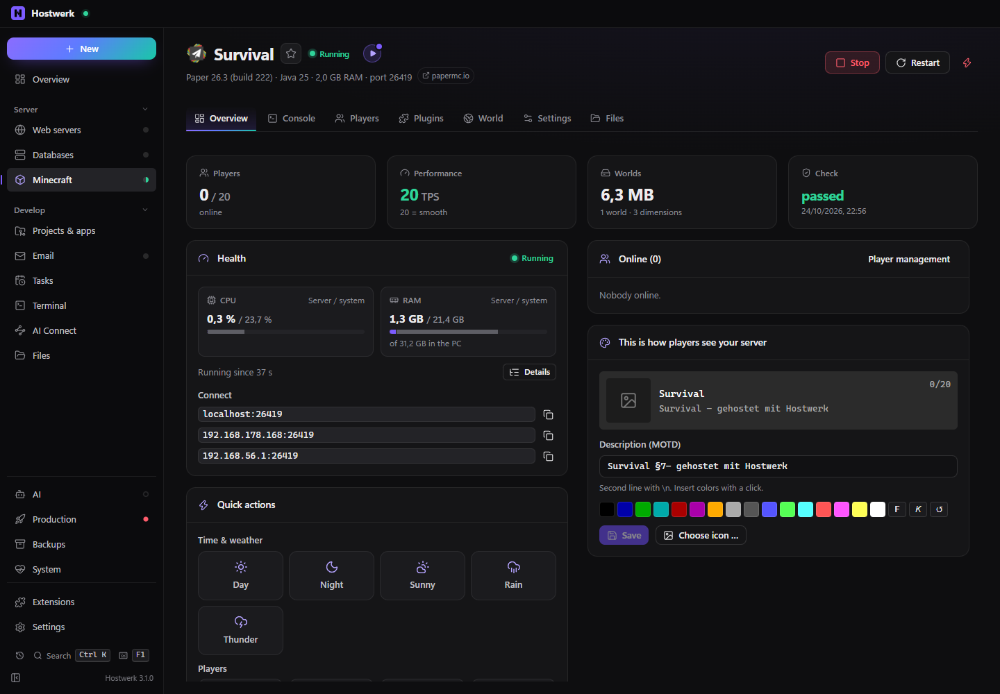

# Minecraft servers

> **Since 1.1 with the MOTD studio:** design the description in the server list right in the overview of every server (colours, gradients, placeholders, variants, a preview like in the game); the big editor with all colour codes is the tab “MOTD studio” in the server list. Anyone who had the “MOTD studio” extension gets this version automatically; variants stay.

Minecraft servers with Paper, Purpur, Folia, Fabric, NeoForge, Forge, Velocity, Bedrock and modpacks: create or take over, console, players, plugins and mods from Modrinth and Hangar, plugin live update without restart, worlds with all dimensions, health in detail, backups, schedule, safe updates with a trial run.

[Deutsch](README.de.md) · An official [Hostwerk](https://github.com/Passimoritz/hostwerk-public) extension (native extension, Hostwerk 3.1 or newer)



## What it does

- **Where:** Minecraft in the sidebar (`#/mc`, as before) – each server with overview, console, players, plugins/mods, worlds, backups and settings
- **Create or take over** servers: Paper, Purpur, Folia, Fabric, NeoForge, Forge, Velocity, Bedrock Dedicated Server and modpacks (Modrinth, CurseForge); existing server folders are taken over where they are
- **Console** with command suggestions, **players** with op, whitelist and bans by right-click, statistics and activity per weekday
- **Plugins and mods** from Modrinth and Hangar, own sources (GitHub, SpigotMC, Jenkins, own project folder), forms for the settings of popular plugins
- **Plugin live update** without restart through the helper plugin HostwerkBridge – also for plugins others depend on (they are reloaded with it); a deploy script or folder watch for your own plugin projects
- **Health in detail:** CPU and RAM as “server / system”, Java memory, CPU per task, worlds, plugins and disk space
- **Worlds with all dimensions** (also from datapacks and mods), reset one by one; icons from the catalog or built from the dimension's real properties
- MOTD and server icon right away, without restart; crop the icon
- Backups, schedule, server check, safe version jumps with plugin check and a trial run on a copy, map (BlueMap), test copy of a server
- An update of the extension keeps running servers running – the new version takes over their processes

For other extensions (service `minecraft`, `ctx.minecraft`):

```js
minecraft.list();          // [{ id, name, type, version, port, … }]
minecraft.info(server);    // details incl. process state, players and address
minecraft.command(id, 'say Hello');
```

Extensions that need it name it under `requires` (`"minecraft": ">=1.0.0"`). Without this extension Hostwerk puts in a placeholder: no servers, otherwise a clear “Minecraft servers are an extension now” message.

## Install

In Hostwerk: **Extensions → Discover** and click “Install”. If you already had Minecraft servers in Hostwerk 3.0 or older, the update to 3.1 installs the extension by itself – with all servers.

Native extensions run as part of Hostwerk (own server and interface part). That is why Hostwerk only installs them from the official catalogue (with checksum) or in developer mode.

## Data

`settings.minecraft` (the list of servers), the server folders under `Hostwerk/minecraft/<id>` (or wherever a taken-over server lives) and backups under `Hostwerk/backups/minecraft/<id>` – exactly where Hostwerk always kept them. Removing the extension stops the servers and deletes nothing.

## Develop

```bash
node --test tests/*.test.js          # tests (no running Hostwerk needed)
node build-native.js .               # build the interface (sdk/build-native.js from hostwerk-public)
node check.js . --strict             # same check as the catalogue (sdk/check.js)
node tools/shots.js                  # README pictures from a throwaway Hostwerk
```

Interface source in `ui/src`, server part in `server/`. Texts in the code are English, German is in `locales/de.json`. The helper plugin HostwerkBridge (`server/bridge`, Java 17, Maven) is built, checked and copied to `server/bridge/HostwerkBridge.jar` in one step: `node tools/bridge.js` (`--check` only compares the committed JAR with the sources). The build is reproducible – unchanged sources give the same JAR byte for byte.

## License

MIT
